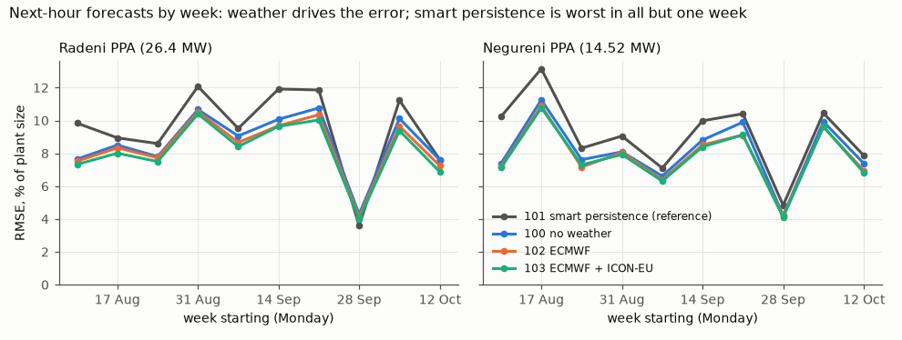
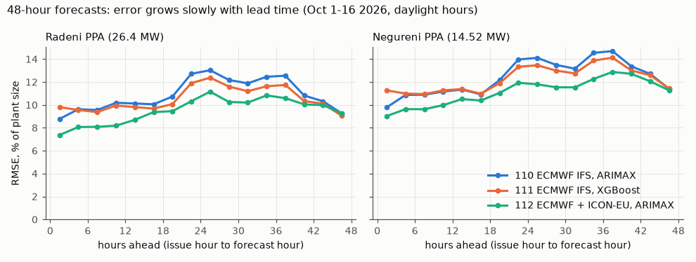
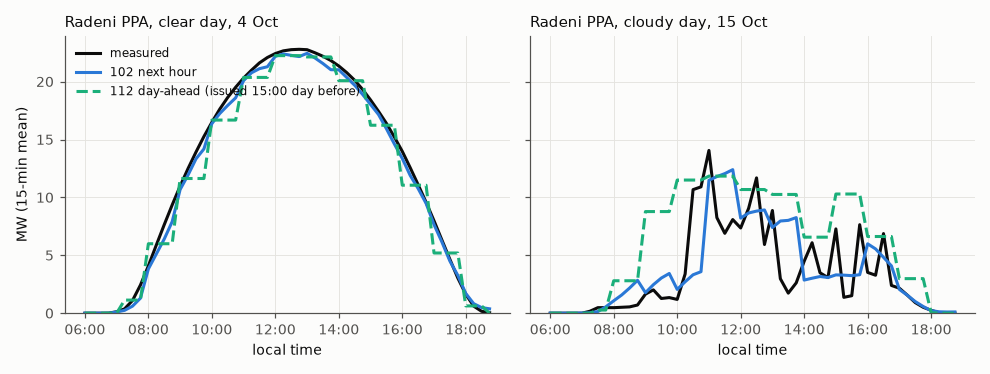

# PV forecast accuracy report

Scored on 2026-10-17. Plants: the two PPA farms, **Radeni PPA (26.4 MW)** and **Negureni PPA (14.52 MW)**.
Forecasts: the forecasts we build ourselves, as written to `integration_schema.forecast_internal`.
Measured output: the active power of the PPA inverter groups (SACUs), read from production.

> **Summary**
>
> - **Next hour:** the typical error is about **8 % of plant size** (RMSE 8.4 % at Radeni, 8.0 % at Negureni;
>   the average absolute error is about 5 %). The best source is **103 `pv_1h_open_meteo_ecmwf_icon_eu`**. It is
>   about **15 % more accurate than smart persistence**, the simple reference forecast.
> - **Day-ahead** (issued at 15:00 for the next day): the typical error is about **11-12 % of plant size**
>   (RMSE 10.4 % at Radeni, 11.9 % at Negureni; average absolute error 8-9 %). The best source is
>   **112 `pv_48h_open_meteo_ecmwf_icon_eu_arimax`**, at both farms and at every lead time.
> - **Over the whole 48-hour forecast**, 112 has an RMSE of 9.5 % (Radeni) and 11.1 % (Negureni). The error grows
>   slowly with lead time: from about 8 % in the first 6 hours to 10-12 % for the next day.
> - **Weather drives the error.** On clear days the next-hour error is about 4 %. On cloudy or broken-cloud days it
>   is about 10-12 %.
> - **Most of these numbers come from a replay, not from live running** (see "How the forecasts were produced").
>   The live job started on 2026-10-17, so no live hours are scored yet. The 48-hour period is short (16 days).

---

## 1. The sources scored

| id | name | horizon | what it is |
|---|---|---|---|
| 100 | `pv_1h_no_weather` | next hour | Statistical models that use recent plant output and the sun's position. No weather forecast. |
| 101 | `pv_1h_smart_persistence` | next hour | **Reference.** The last hour's output, taken relative to clear sky and carried forward. |
| 102 | `pv_1h_open_meteo` | next hour | Like 100, plus the ECMWF IFS weather forecast. |
| 103 | `pv_1h_open_meteo_ecmwf_icon_eu` | next hour | Like 102, but uses the mean of the ECMWF IFS and ICON-EU weather forecasts. |
| 110 | `pv_48h_open_meteo_ecmwf_ifs_arimax` | 0-48 h | ARIMAX model on the ECMWF IFS weather forecast. |
| 111 | `pv_48h_open_meteo_ecmwf_ifs_xgboost` | 0-48 h | XGBoost model on the ECMWF IFS weather forecast. |
| 112 | `pv_48h_open_meteo_ecmwf_icon_eu_arimax` | 0-48 h | ARIMAX model on the mean of the ECMWF IFS and ICON-EU forecasts. |

## 2. How we measure

- **Unit:** hourly mean power (MW). An hour counts only when all four 15-minute values exist, for both the forecast
  and the measured output.
- **Daylight only:** an hour is scored only when measured output is at least 0.5 MW. Nights and the first and last
  minutes of daylight do not count.
- **Error measures,** all in % of the farm's nameplate (26.4 MW or 14.52 MW):
  - **RMSE** (root mean square error) is the headline number. It punishes large misses more than small ones.
  - **MAE** (mean absolute error) is the typical size of a miss.
  - **Bias** is forecast minus actual, on average. A positive bias means we forecast too high.
- **Skill vs 101** = 1 - RMSE / RMSE of smart persistence. For example, 0.15 means 15 % less RMSE than the
  reference. A value of 0 means no better than the reference.
- **Fair comparison:** inside each table, all sources are scored on exactly the same hours.
- **Missing actuals are left out,** never filled in. The measured value of a 15-minute slot is treated as missing
  when an inverter group has no data, has too few readings, repeats a frozen value, or reads above 105 % of its
  rating. Over the period this removed 27 hours at Radeni and 9 at Negureni (before the daylight filter).
- **Is a difference real?** We resample whole days 2,000 times and give a 90 % range for the difference. If the
  range does not include 0, the difference is real for this period.
- **48-hour lead time** = forecast hour minus the hour the forecast was issued. Every issued run is scored, not only
  the newest one.

## 3. Next-hour forecasts (100-103)

Period: 2026-08-12 to 2026-10-16 (66 days). Radeni: 756 daylight hours. Negureni: 712 daylight hours.

| farm | source | RMSE % | MAE % | bias % | skill vs 101 |
|---|---|---:|---:|---:|---:|
| Radeni | 100 no weather | 8.91 | 5.57 | -0.16 | 0.10 |
| Radeni | 101 smart persistence | 9.92 | 5.73 | -0.33 | 0 (reference) |
| Radeni | 102 ECMWF | 8.65 | 5.34 | -0.12 | 0.13 |
| Radeni | **103 ECMWF + ICON-EU** | **8.43** | **5.20** | -0.22 | **0.15** |
| Negureni | 100 no weather | 8.39 | 5.14 | -0.49 | 0.11 |
| Negureni | 101 smart persistence | 9.43 | 5.32 | -0.62 | 0 (reference) |
| Negureni | 102 ECMWF | 8.07 | 4.91 | -0.66 | 0.15 |
| Negureni | **103 ECMWF + ICON-EU** | **8.01** | **4.88** | -0.75 | **0.15** |

**Are the differences real?** (RMSE difference in points of nameplate, with the 90 % range)

| farm | comparison | difference | 90 % range | verdict |
|---|---|---:|---|---|
| Radeni | 102 vs 101 | -1.27 | -1.61 .. -0.92 | 102 better |
| Radeni | 103 vs 101 | -1.49 | -1.83 .. -1.14 | 103 better |
| Radeni | 103 vs 102 | -0.22 | -0.28 .. -0.15 | 103 slightly better |
| Negureni | 102 vs 101 | -1.37 | -1.77 .. -0.97 | 102 better |
| Negureni | 103 vs 101 | -1.42 | -1.83 .. -1.00 | 103 better |
| Negureni | 103 vs 102 | -0.06 | -0.13 .. +0.02 | about the same |

All three models clearly beat smart persistence at both farms. Adding a weather forecast (102) helps a little more
than the no-weather model (100). Adding ICON-EU to ECMWF (103) gives a small extra gain at Radeni and about none at
Negureni. Bias is small: within 1 % of plant size, slightly low on average.

**Trend by month** (RMSE %, same hours for all sources)

| farm | month | days | 100 | 101 | 102 | 103 |
|---|---|---:|---:|---:|---:|---:|
| Radeni | Aug (from 12th) | 20 | 7.85 | 8.89 | 7.72 | 7.47 |
| Radeni | Sep | 30 | 10.00 | 11.18 | 9.69 | 9.51 |
| Radeni | Oct (to 16th) | 16 | 7.98 | 8.49 | 7.60 | 7.32 |
| Negureni | Aug (from 12th) | 20 | 8.80 | 10.52 | 8.47 | 8.44 |
| Negureni | Sep | 30 | 8.34 | 9.12 | 8.00 | 7.93 |
| Negureni | Oct (to 16th) | 16 | 7.86 | 8.39 | 7.57 | 7.52 |

The error goes up and down with the weather, not steadily up or down. There is no sign that the models get worse
over time. The week-by-week table is in `scores_1h_trend.csv`. Smart persistence was the worst source in every week
except the very clear week of 28 Sep at Radeni, when simply repeating the last hour is hard to beat.

**Clear vs cloudy days** (RMSE %). Each day is graded by its measured energy compared with a clear-sky day: clear
(85 % or more), mixed (60-85 %), cloudy (below 60 %).

| farm | sky | days | 101 | 102 | 103 |
|---|---|---:|---:|---:|---:|
| Radeni | clear | 28 | 4.72 | 4.10 | 3.98 |
| Radeni | mixed | 20 | 14.24 | 11.73 | 11.54 |
| Radeni | cloudy | 18 | 9.97 | 9.83 | 9.43 |
| Negureni | clear | 26 | 4.03 | 3.61 | 3.55 |
| Negureni | mixed | 17 | 11.97 | 10.00 | 9.94 |
| Negureni | cloudy | 23 | 11.70 | 10.13 | 10.07 |

- **Best days** are clear days, with an RMSE of 1-2 %. Examples: 31 Aug, 15-16 Aug and 9 Sep at Radeni; 31 Aug,
  22 Aug and 3 Oct at Negureni.
- **Worst days** are broken-cloud days, with an RMSE of 15-27 %. Examples: 22 Sep, 3 Sep and 11 Oct at Radeni;
  23 Aug, 9 Oct and 19 Sep at Negureni. On these days output jumps by many MW within an hour, and no next-hour
  forecast can follow every jump.
- The models gain the most over smart persistence on **mixed** days (about 2.5 points at Radeni).

## 4. 48-hour forecasts (110-112)

Period: runs issued every hour from 2026-10-01 00:00 local to 2026-10-16. That is 376 runs scored per farm. Each run
covers 48 hours.

**By lead time** (RMSE / MAE / bias in % of nameplate, same hours for all three sources)

| farm | lead | hours | 110 RMSE | 111 RMSE | **112 RMSE** | 112 MAE | 112 bias |
|---|---|---:|---:|---:|---:|---:|---:|
| Radeni | 0-6 h | 978 | 9.21 | 9.68 | **7.73** | 5.49 | -1.15 |
| Radeni | 6-24 h | 2,808 | 10.59 | 10.15 | **9.03** | 6.74 | -0.50 |
| Radeni | 24-48 h | 3,498 | 11.66 | 11.08 | **10.32** | 7.39 | +0.85 |
| Radeni | all 0-48 h | 7,284 | 10.95 | 10.55 | **9.52** | 6.88 | +0.06 |
| Negureni | 0-6 h | 936 | 10.34 | 11.13 | **9.33** | 6.53 | -2.22 |
| Negureni | 6-24 h | 2,687 | 11.77 | 11.65 | **10.59** | 8.13 | -2.56 |
| Negureni | 24-48 h | 3,359 | 13.49 | 13.07 | **12.02** | 9.12 | -0.85 |
| Negureni | all 0-48 h | 6,982 | 12.46 | 12.29 | **11.15** | 8.39 | -1.69 |

(The MAE and bias of 110 and 111 are in `scores_48h_by_lead_bucket.csv`.)

- **112 is the best 48-hour source** at both farms and in every lead bucket. Over all leads it beats 110 by about
  1.3-1.4 points. The 90 % range excludes 0 in every bucket: -0.5 .. -2.4 at Radeni and -0.6 .. -2.1 at Negureni
  for all leads. This means averaging two weather models pays off.
- **111 (XGBoost) vs 110 (ARIMAX)** is mixed. 111 is worse in the first 6 hours (clearly so at Negureni) and
  slightly better after 6 hours.
- **Negureni is forecast too low:** about -2 to -2.5 % of plant size in the first 24 hours, for all three sources.

### Day-ahead view (issued 15:00 local, scored on the next local day)

This view uses the run issued at 15:00 local time (12:00 UTC) and scores all daylight hours of the next calendar
day, which are about 9 to 28 hours ahead. Delivery days: 2 to 16 October (15 days).

| farm | source | hours | RMSE % | MAE % | bias % |
|---|---|---:|---:|---:|---:|
| Radeni | 110 ARIMAX, ECMWF | 151 | 13.14 | 9.17 | +1.93 |
| Radeni | 111 XGBoost, ECMWF | 151 | 12.33 | 8.55 | +1.43 |
| Radeni | **112 ARIMAX, ECMWF + ICON-EU** | 151 | **10.44** | **7.94** | +0.62 |
| Negureni | 110 ARIMAX, ECMWF | 145 | 14.13 | 10.46 | -0.42 |
| Negureni | 111 XGBoost, ECMWF | 145 | 13.43 | 9.99 | -1.01 |
| Negureni | **112 ARIMAX, ECMWF + ICON-EU** | 145 | **11.86** | **9.29** | -1.35 |

112 vs 110, day-ahead: -2.7 points at Radeni (90 % range -4.7 .. -0.5) and -2.3 points at Negureni
(-3.5 .. -0.9). The day-ahead numbers are higher than the "24-48 h" bucket above for two reasons. First, they come
from one run per day instead of every run. Second, the last five days (12-16 Oct) were cloudy, and day-ahead error
on those days reached up to 20 %. On clear days, day-ahead error was mostly 3-9 %. 112 did not win every day: on 5, 6 and 10 Oct (and 9 Oct at Radeni),
110 or 111 was closer. Daily scores are in `scores_dayahead_daily.csv`.

**Bias by time of day (day-ahead 112).** At Radeni, 112 is too low in the morning (-2.4 to -4.7 % at 09:00-11:00) and
too high around midday and early afternoon (+3.5 to +5 % at 12:00-15:00). Negureni shows the same morning dip
(-3 to -6 % at 09:00-10:00) and a smaller midday excess. This looks like a timing or shape error in the weather
input, not a fault in one model. It is worth watching, but 15 days are too few to correct for it. The next-hour
forecast (102) has no such pattern: its hourly bias stays within about ±2.5 %. See `bias_by_local_hour.csv`.

*Left: a clear day. Both forecasts follow the measured output closely. Right: a cloudy day. The next-hour
forecast (102) follows the changes with a lag. The day-ahead forecast (112) sets the right overall level but cannot
place the individual cloud gaps. The 48-hour models give one value per hour, so their line moves in hourly steps.*

## 5. How the forecasts were produced, and other caveats

- **Mostly replayed, not live.** Every scored row is a **walk-forward replay** (`is_backfill = 1`). The models were
  retrained once a week, each time only on data from before that week. Each hour was then forecast with the weather
  forecast runs as they were published at that time. No future data was used. This is a fair test, but it is not
  the same as live running: live runs can be late, can miss data or can fail. The live hourly job started writing on
  2026-10-17 (`is_backfill = 0`). No live hour falls in the scored period yet, so the live results should be
  checked in a few weeks.
- **Short periods.** The next-hour results cover 66 days of late summer and early autumn. The 48-hour results cover
  16 days of October, and the day-ahead view only 15 delivery days. Winter (low sun, fog, snow on panels) has not
  been tested. Treat the 48-hour numbers as a first reading.
- **PPA farms only.** The FREE farms at the same sites receive the PPA forecast, rescaled by nameplate. They are not
  scored here, because FREE output is often held back by dispatch instructions. Their measured power shows what
  dispatch allowed, not what the sun allowed. The Valea Mare site has no PPA part and is not covered.
- **"Actual" means measured active power** of the PPA inverter groups: Radeni SACUs 1-4, Negureni SACUs 3-4. The PPA
  part is not curtailed by dispatch. We saw no signs of a cap: the highest 15-minute output was 96 % of nameplate at
  Radeni and 98 % at Negureni, only 2 slots per farm reached 95 %, and clear days show smooth, rounded curves with no
  flat top. We did not check this against the setpoint tables.
- **Errors are in % of nameplate, not % of production.** In October the plants produce less, so the same MW error
  is a larger share of the energy actually produced.
- **Daylight threshold.** Hours below 0.5 MW are not scored. Adding them would make every source look better,
  because those hours are easy.
- **Clock change (DST).** The scored period has no clock change. The next one is on 25 Oct 2026. During that night,
  the repeated hour's measured values cannot be placed in UTC, so they are left out by design.
- **Negative forecasts** are set to 0 before writing, which is a project rule. They are scored as written.

## 6. Files

All of these are next to this report.

| file | content |
|---|---|
| `scores_1h.csv` | next-hour RMSE / MAE / bias / skill per farm and source |
| `scores_1h_differences.csv` | next-hour differences between sources with 90 % ranges |
| `scores_1h_trend.csv` | next-hour RMSE per month and per week |
| `scores_1h_by_sky.csv` | next-hour RMSE on clear / mixed / cloudy days |
| `scores_1h_daily.csv` | next-hour RMSE per day, with the day's clear-sky index |
| `scores_48h_by_lead_bucket.csv` | 48-hour RMSE / MAE / bias per lead bucket |
| `scores_48h_by_lead_hour.csv` | 48-hour RMSE per single lead hour (0-47) |
| `scores_48h_differences.csv` | 112 vs 110 and 111 vs 110 with 90 % ranges, per bucket and day-ahead |
| `scores_dayahead.csv`, `scores_dayahead_daily.csv` | day-ahead (15:00 run) scores, total and per day |
| `bias_by_local_hour.csv` | bias by local hour, next-hour 102 and day-ahead 112 |
| `figures/*.png` | the three charts above |
